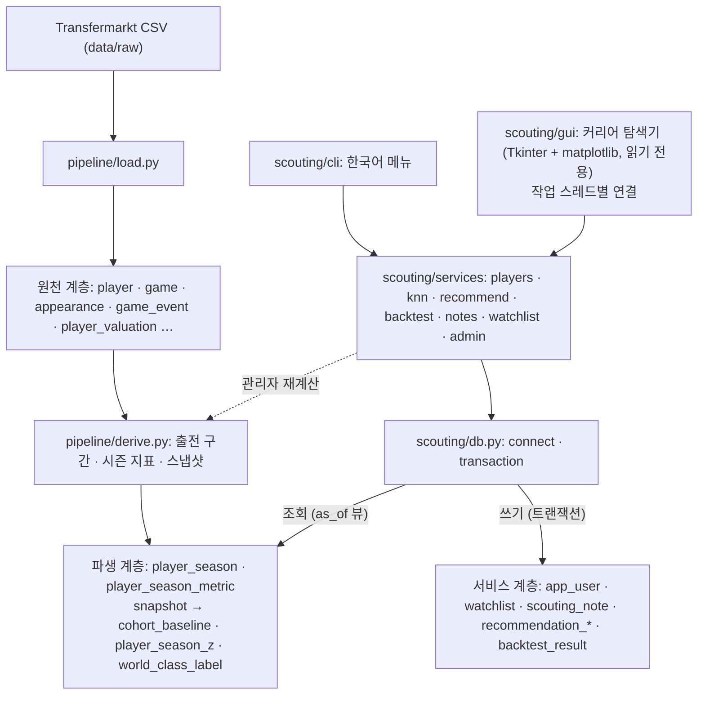

# 축구 유망주 스카우팅 DB — "다음 월드클래스" 추천

DB 텀프로젝트. 선수들의 시즌별 성장 기록을 SQLite에 쌓는다. 같은 나이 시점의 기록으로 월드클래스가 된 선수와 현재 유망주를 비교해 다음 월드클래스 후보를 추천하는 CLI 서비스다.

- DB: SQLite ≥ 3.37 (STRICT 테이블), 단일 파일 `data/scouting.sqlite`
- 언어: Python ≥ 3.11, 런타임은 표준 라이브러리만 사용
- 데이터: [Transfermarkt datasets](https://github.com/dcaribou/transfermarkt-datasets) (CC0), 2026-07-06 스냅샷

## 설치와 DB 구축

```bash
git clone https://github.com/wobeen/DB_TermProject.git
cd DB_TermProject
pip install -r requirements.txt                       # pytest, matplotlib (테스트·벤치용, CLI만 쓸 거면 생략 가능)
python scripts/setup_db.py                            # 다운로드 → 적재 → 파생 계산 → 스냅샷 current·bt2018 (약 8~9분)
python -m scouting create-admin admin --password admin1234
```

- `data/`는 git에 올라가지 않는다. 새로 받은 저장소에서는 반드시 `setup_db.py`를 먼저 실행한다.
- `setup_db.py` 옵션: `--db PATH`, `--raw data/raw`, `--force`(기존 DB를 지우고 다시 만듦).
  - 원천 zip(약 240MB)은 sha256을 확인하고 이미 있으면 다시 받지 않는다.
  - 적재 결과는 `data/load_report.json`에 남는다.
- 디스크는 원천 약 0.5GB와 DB 약 0.85GB가 필요하다.
- 백테스트 스냅샷 `bt2019`, `bt2020`은 `bench/run_all.py`가 추가한다.

## GUI 사용 방법: 선수 커리어 탐색기

```bash
python -m scouting.gui                # 기본 DB(data/scouting.sqlite)
python -m scouting.gui --db PATH      # 다른 DB 파일
```

Tkinter 데스크톱 창이 뜬다. 로그인이 필요 없는 **읽기 전용** 화면으로, 선수를 찾아 이적 이력·시즌별 기록·시장가치 커리어를 본다.

- 추가 설치는 없다. 그래프는 requirements의 matplotlib을 쓴다.
- 고해상도(배율 200%) 화면에 맞춰 글꼴과 그래프 크기가 조정된다.
- 추천·월클·백테스트 같은 스카우팅 기능은 CLI에만 있다.

1. **데이터 기준 확인**: 상단 띠 오른쪽에 데이터 기준일이 항상 표시된다(경기 2026-07-06, 시장가치 2026-06-12). 2025/26 시즌까지만 있고 그 이후 이적은 반영되지 않는다.
2. **선수 검색**(왼쪽 조건 → `검색`)
   - **이름**: 2글자부터 연관 선수 목록이 뜬다(↑/↓ 이동, Enter 선택, Esc 닫기). 목록에서 고르면 그 선수의 커리어가 바로 열린다. 목록을 고르지 않고 Enter나 `검색`을 누르면 일반 검색을 한다.
   - **포메이션 → 포지션**: 포메이션(4-4-2, 4-3-3, 4-2-3-1, 4-1-4-1, 4-4-1-1, 3-5-2, 3-4-3, 5-3-2, 5-4-1)을 고르면 경기장 그림에 자리가 나온다. 원하는 자리(GK, LB, CB, RB, LWB, RWB, DM, CM, LM, RM, AMC, AML, AMR, ST)를 눌러 고르며, 여러 개를 함께 고를 수 있다.
     - 선수의 **등록 주 포지션** 기준이다(예: AMR = Right Winger, ST = Centre-Forward·Second Striker).
   - **국적**: 영어 국가명이나 한글 별칭(한국, 잉글랜드, 스페인 등)으로 찾고 목록에서 고른다. 목록에 없는 값으로는 검색되지 않는다.
   - **거쳐 간 구단**: `리그`(예: Premier League (England))를 고른 뒤 `구단`(예: Liverpool FC, 또는 `리그 전체`)을 고른다. 또는 `구단 이름으로 찾기`에 이름 일부를 치면 후보가 뜬다(예: `Tot` → Tottenham Hotspur). 둘 다 쓰면 드롭다운에서 고른 구단이 우선이고, 적용 중인 조건이 아래에 표시된다.
     - 구단 조건이 있으면 결과에 **재직 기간** 열이 생긴다(예: `2022-07 ~ 2025-08`, `2025-07 ~ 현재`). 이적 기록이 없는 선수는 출전 기록으로 계산한다. 이 경우 출전 기록이 시작되는 2012/13 시즌에 걸친 기간은 실제로 더 길 수 있어서 `(2012/13 이전 미수록)`을 붙인다.
   - **나이 범위**: 기준일 기준 만 나이로 거른다.
   - 결과에 총 인원과 페이지가 표시되고 `이전`/`다음`으로 넘긴다. 행을 더블클릭하거나 `커리어 보기`를 누른다.
3. **커리어 화면**
   - 프로필: 이름, 생년월일, 국적, 포지션(코드 포함), 주발, 키, 현재 구단, 현재·최고 시장가치
   - **커리어 경로 띠**: 구단별 재직 기간을 시간축 위 블록으로 보여 준다. 시장가치·출전 기록 이전 시기는 `유스` 블록 하나로 묶는다. 같은 구단으로 돌아오면 같은 색이고, 이적료가 있는 이적은 노란 눈금으로 표시한다. 블록에 커서를 올리면 구단 전체 이름과 재직 기간이 뜬다.
   - **시장가치 그래프**: 띠와 같은 시간축이다. 선에 커서를 올리면 가장 가까운 시점의 날짜, 금액, 당시 소속 구단이 뜬다.
   - 시즌별 기록: 시즌(2024/25 표기)별 합계 한 줄씩 보여 주고 `＋`로 대회별 행을 펼친다. `전체 대회` / `리그만`, `모두 펼치기`
   - 그래프: 시즌별 출전 시간(막대)과 공격포인트(선)
   - 이적 이력: 최근 5건을 보여 주고 `전체 보기`로 유스 시절부터 전부 펼친다. 기준일 이후 날짜는 `(예정)`으로 표시한다.
4. **이동**: `← 검색 결과`로 검색 화면에 돌아간다. `◀` / `▶`로 검색 결과의 이전·다음 선수로 넘어간다(페이지를 넘어서도 이어지며 `3 / 153`처럼 위치를 표시한다).

- 수록 범위: 유럽 1부 14개 리그, 국내컵, UEFA 대회, 주요 국가대항전. MLS·K리그 등 그 밖의 리그 경기 기록은 없다(이적 이력에는 나온다).
- 하단 상태줄에 진행 중인 작업, 소요 시간, 오류가 나온다.
- 스크린샷은 `report/figures/gui_search.png`, `gui_career.png`에 있다. `python scripts/capture_gui.py`로 다시 찍을 수 있다(DB 복사본을 쓰므로 원본은 바뀌지 않는다).

## CLI 사용 방법

```bash
python -m scouting                  # 기본 DB(data/scouting.sqlite)
python -m scouting --db PATH        # 다른 DB 파일
```

공통 조작 규칙:
- 메뉴 번호를 입력하고 Enter를 누른다.
- `0`은 뒤로/로그아웃/종료다. 빈 입력은 취소 또는 기본값이다.
- 잘못된 값을 넣으면 안내 후 같은 항목을 다시 묻는다. Ctrl+C로 언제든 종료할 수 있다.
- 선수를 고를 때는 선수 ID를 바로 넣거나, 이름 일부를 넣고 목록에서 ID를 고른다.
- 검색 결과가 많으면 `n`/`p`로 페이지를 넘긴다.
- 스냅샷은 기준 시점이다. `current`(2026-07-07)는 현재 추천용이고, `bt2018` 등은 과거 시점 재현·백테스트용이다. 스냅샷 기준 화면에는 그 날짜 이전 데이터만 나온다.

### 1) 계정
1. `2 회원가입`: 사용자명(3~32자)과 비밀번호(4자 이상)를 입력한다. 가입하면 scout 권한이 된다.
2. `1 로그인`
3. 관리자 계정은 터미널에서 `python -m scouting create-admin <이름> --password <비번>`으로 만든다.
4. 관리자는 메뉴 13에서 다른 사용자의 역할을 바꿀 수 있다.

### 2) 스카우트 메뉴

| 메뉴 | 하는 일 | 입력 예 |
|---|---|---|
| 1 선수 검색 | 이름·포지션군(GK/DF/MF/FW)·최대 나이·리그 ID로 찾는다 | 이름 `Son`, 포지션 `FW`, 리그 `GB1` |
| 2 선수 프로필 | 시즌별 성장표(포지션별 지표), 시즌별 시장가치 요약, 스냅샷 기준 동나이대 백분위 | `Heung-min` → ID `91845` → 스냅샷 `current` |
| 3 유사 선수 Top-k | 같은 나이·포지션의 과거 선수 중 지표가 가장 비슷한 k명. 월클 여부를 표시한다 | `91845` → 스냅샷 `bt2018` → k 빈 입력(10) → 정의 `peak_value_50m` |
| 4 다음 월클 추천 | 스냅샷·월클 정의·포지션·방식을 고르면 상위 20명을 추천하고 기록을 저장한다 | `current` → `peak_value_50m` → `FW` → `similarity` → 기본값 `y` |
| 5 내 추천 기록 | 저장된 run 목록 → run 상세 → 선수별 근거 이웃(비슷했던 과거 선수) | run 번호 → 선수 ID |
| 6 워치리스트 | 관심 선수 조회·추가(메모)·메모 수정·삭제(y/n 확인) | |
| 7 스카우팅 노트 | 선수별 평점(1~5)과 메모 작성·조회·수정·삭제. 본인 노트만 수정·삭제할 수 있다 | |
| 8 기준 돌파 유망주 | 같은 나이 시점 월클들과 지표를 비교한다. `all`은 전원보다 높은 선수, `some`은 한 명 이상보다 높은 선수다 | `current` → 정의 → `FW` → 지표 `minutes_share` → `some` |

추천 방식(메뉴 4):
- `random`: 무작위 기준선
- `market_value`: 기준 시점 시장가치 순위(현업의 기준선)
- `similarity`: 비슷한 과거 선수 중 월클이 된 비율
- `hybrid`: similarity와 시장가치 순위를 반반 결합

`n`을 고르면 고급 설정(max_age, min_minutes, k, top_n, pool_lag, seed)을 바꿀 수 있다. 실데이터에서 한 번 실행하는 데 10초 안팎 걸린다.

### 3) 관리자 메뉴 (admin 로그인 시 추가)

| 메뉴 | 하는 일 |
|---|---|
| 9 데이터 현황 | 테이블별 행 수, 스냅샷 목록과 빌드 시각 |
| 10 스냅샷 재계산 | 선택한 스냅샷의 코호트 기준치·z-score·라벨을 다시 계산한다(약 20~60초, 그동안 다른 쓰기는 대기) |
| 11 월클 정의 관리 | 정의 조회·추가·수정·삭제. 수정하면 라벨을 자동으로 다시 계산한다. 추천 기록이 참조하는 정의는 삭제할 수 없다 |
| 12 백테스트 | 과거 스냅샷(`bt2018` 등)으로 만든 run을 고르고 결과 스냅샷(`current`)을 골라 precision/recall을 본다 |
| 13 사용자 역할 변경 | scout ↔ admin |

백테스트 예시:
1. 메뉴 4에서 스냅샷 `bt2018`, 포지션 `DF`, 방식 `market_value`로 추천한다. 백테스트는 top_n 50을 권장한다(고급 설정 `n`).
2. 메뉴 12에서 그 run을 고른다.
3. 결과 스냅샷으로 `current`를 고른다.

### 4) 자주 나오는 문제

| 증상 | 원인과 해결 |
|---|---|
| `[오류] DB 파일을 열 수 없습니다` / `경로가 디렉터리입니다` | `--db` 경로를 확인한다. DB가 없으면 `python scripts/setup_db.py`를 실행한다 |
| `다른 작업이 DB를 사용 중입니다` | 스냅샷 재계산이나 벤치 실험이 쓰기 중이다. 끝난 뒤 `y`로 다시 시도한다 |
| 추천 결과가 비어 있음 | 해당 포지션·나이·출전 시간 조건의 후보가 없다. 고급 설정에서 max_age나 min_minutes를 조정한다 |
| GK 백테스트 수치가 모든 방식에서 같음 | GK 후보는 5~10명뿐이라 precision@20으로는 비교할 수 없다 |
| `bench/run_all.py`가 중간에 끊김 | 약 50분 걸리고 메모리를 많이 쓴다. 다른 앱을 닫고 다시 실행하거나 `--quick`을 쓴다 |

## 구조



- 원천 출전 기록 188만 건을 질의마다 집계하지 않고, 선수×시즌 사실과 표준화 점수를 미리 만들어 둔다. 결과는 같고 16~6,237배 빠르다(`bench/results/SUMMARY.md`).
- z-score와 라벨은 스냅샷별로 저장되고, `v_*_asof` 뷰는 기준일 이전 데이터만 보여 준다. 그래서 과거 시점 추천에 미래 정보가 섞이지 않는다.
- 모든 쓰기는 `scouting/db.py`의 트랜잭션을 거친다. 노트·워치리스트의 수정·삭제는 `AND user_id = ?`로 본인 것만 바뀐다.

## 테스트와 실험

```bash
python -m pytest -q          # tests/pipeline + tests/app (실DB 테스트는 DB가 없거나 잠겨 있으면 skip)
python bench/run_all.py      # 질의 성능 B1/B2/P, 갱신 비용, cProfile, 백테스트 (약 50분)
python bench/run_all.py --quick
```

실험 결과와 해석은 `bench/results/SUMMARY.md`에 있다. 원본 수치는 `bench/results/*.csv`, 실행 계획은 `explain/`, 그래프는 `figures/`에 있다.

## 보고서

`report/report.pdf` (영어, A4 6페이지). 원문은 `report/report.md`다.

```bash
pip install python-docx docx2pdf pymupdf matplotlib   # 보고서 빌드 전용
python report/make_figures.py                          # 그림 재생성(선택)
python report/build.py                                 # report.md → report.docx → report.pdf, PDF 페이지 수 출력
```

- 이름·학번은 `report/report.md` 첫 부분(제목 아래 줄)에 넣고 다시 빌드한다.
- 출력되는 `PDF pages:`가 6인지 확인한다.
- PDF 변환에는 Microsoft Word가 필요하다. Word가 없으면 `--no-pdf`로 DOCX만 만든다.
- 자세한 내용은 [report/README.md](report/README.md)에 있다.

## 저장소 구조

| 경로 | 내용 |
|---|---|
| `docs/REQUIREMENTS.md` | 강의자료 기반 요구사항과 최종 검증 체크리스트(R-ID) |
| `docs/PLANS.md` | 기획안 후보와 선정 이유(기획안 E) |
| `docs/CONTRACT.md` | 데이터 검증 결과, 적재·파생 공식, 추천·백테스트 규칙, API, CLI, 벤치 명세 |
| `docs/reviews/` | 교차 리뷰 결과 |
| `db/` | `schema.sql`, `views.sql`, `indexes.sql`, `reference_data.sql` |
| `pipeline/`, `scripts/` | 다운로드, 적재, 파생 계산, `setup_db.py` |
| `scouting/` | DB 연결(`db.py`), 서비스 계층(`services/`), CLI(`cli/`), GUI(`gui/`) |
| `tests/` | `pipeline/`, `app/`, `gui/` |
| `bench/` | 성능·백테스트 실험과 결과 |
| `report/` | 보고서 원문, 빌드 스크립트, 그림, CLI 출력 기록 |
