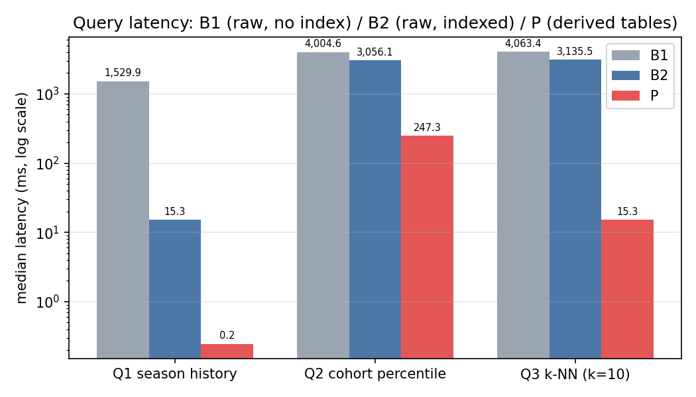
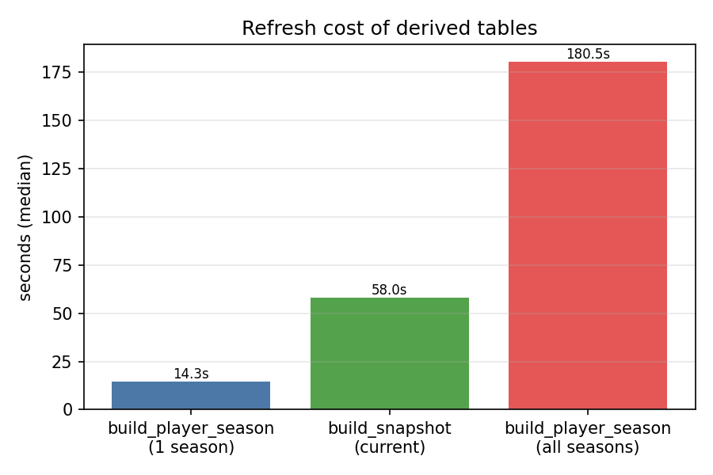
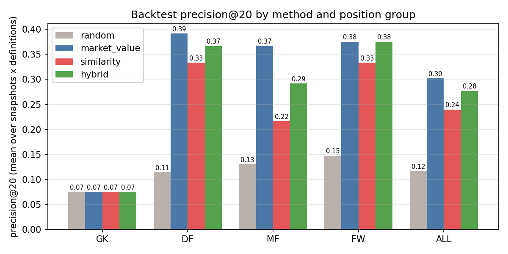

# 벤치마크 요약 (BenchAgent)

실행 모드: **full**. 모든 수치는 `bench/run_all.py` 가 생성한 CSV에서 온다. 재현: `python bench/run_all.py`.

## 0. 실험 설계와 편차 (보고서에 반드시 밝힐 것)

- **구성**: B1 = 원천 경로 + 보조 인덱스 없음(`data/bench_b1.sqlite`, 메인 DB 복사 후 `ix_*` 15개 DROP + VACUUM), B2 = 원천 경로 + 인덱스(메인 DB), P = 파생 테이블 + 인덱스(서비스 함수 `season_history`, `cohort_percentiles`, `similar_players` 직접 호출).
- **표본**: 시즌 L=2025, 리그 900분 이상, **16~21세**(추천 후보 규칙 max_age=21과 맞춤), seed 42, 포지션군별 5명 = 20명. P 결과가 비어 있지 않은 선수만 포함.
- **원천 경로**(`raw_queries.py`): §3.2 공식(출전 구간·선발 판정·on-pitch 득실·주 소속 구단·리그 수준·지표)을 단일 `WITH` 질의의 CTE로 매번 계산한다. 계산 범위는 질의가 필요로 하는 (선수, 시즌)으로 좁힌다 — Q1은 한 선수의 전 시즌, Q2/Q3는 같은 포지션군·같은 나이 코호트의 전 시즌(코호트 평균/표준편차가 필요하므로). Q3의 이웃 월클 라벨도 원천(시장가치/출전)에서 이웃 k명에 대해서만 계산한다. TEMP 테이블은 쓰지 않았고 `AS MATERIALIZED` 힌트와 Q1의 `CROSS JOIN`(조인 순서 고정: 선수→출전)만 썼다.
- **공통 입력으로 취급한 것**: `competition_season_strength`(14리그×14시즌의 작은 참조 집계), `metric`, `metric_weight`, `world_class_definition`. 리그 수준 집계는 전 선수 시장가치 평균이라 질의마다 재계산하면 비현실적이어서 두 경로가 공유한다.
- **Q3 지연 측정은 월클 정의 1(peak_value_50m)** 로 한다. 정합성 검증은 정의 1, 2 모두 수행한다(B1+정의2는 라벨 계산이 appearance 전체 스캔이라 질의당 약 50초여서 앞 3명만 검증).
- **측정 횟수 편차**: 계약은 워밍업 3 + 측정 30이지만, 원천 경로의 Q2/Q3는 질의 1회가 수 초~수십 초라 **워밍업 1 + 선수당 5회**(Q1 B1은 선수당 10회)로 줄였다. P와 Q1(B2)은 워밍업 3 + 선수당 30회. 정확한 값은 `query_summary.csv`의 `warmup`, `runs_per_player`, `n_samples` 열과 `env.json`에 있다. 20명 × 5회 = 100개 표본으로 median/p95를 계산했다.

## 1. 정합성 검증 (원천 경로 == P)

지표 오차 1e-9 이하, 이웃 (player_id, season) 순서 동일, 이웃 월클 여부 동일.

| 항목 | 선수 수 | 결과 |
|---|---|---|
| Q1/B2 | 20 | PASS |
| Q1/B1 | 20 | PASS |
| Q2/B2 | 20 | PASS |
| Q2/B1 | 20 | PASS |
| Q3/B2/def1 | 20 | PASS |
| Q3/B2/def2 | 20 | PASS |
| Q3/B1/def1 | 20 | PASS |
| Q3/B1/def2 | 3 | PASS |

## 2. 질의 지연시간 (ms)

| 질의 | 구성 | median | p95 | B1 대비 속도 향상 | warmup | 선수당 측정 | 표본 수 |
|---|---|---|---|---|---|---|---|
| Q1 | B1 | 1,529.88 | 1,632.16 | 1.0x | 1 | 10 | 200 |
| Q1 | B2 | 15.26 | 22.72 | 100.3x | 3 | 30 | 600 |
| Q1 | P | 0.25 | 0.40 | 6,236.8x | 3 | 30 | 600 |
| Q2 | B1 | 4,004.57 | 4,458.73 | 1.0x | 1 | 5 | 100 |
| Q2 | B2 | 3,056.09 | 3,581.21 | 1.3x | 1 | 5 | 100 |
| Q2 | P | 247.34 | 302.52 | 16.2x | 3 | 30 | 600 |
| Q3 | B1 | 4,063.40 | 4,408.22 | 1.0x | 1 | 5 | 100 |
| Q3 | B2 | 3,135.54 | 3,630.22 | 1.3x | 1 | 5 | 100 |
| Q3 | P | 15.27 | 21.05 | 266.2x | 3 | 30 | 600 |

- Q1: B1→B2 100.3x, B2→P 62.2x, B1→P 6236.8x
- Q2: B1→B2 1.3x, B2→P 12.4x, B1→P 16.2x
- Q3: B1→B2 1.3x, B2→P 205.4x, B1→P 266.2x



## 3. 개선 이유

### 3.1 EXPLAIN QUERY PLAN (`explain/<Q>_<config>.txt`)

| 질의 | 구성 | 원천/파생 테이블 SCAN 수 | 인덱스 SEARCH 수 | AUTOMATIC INDEX 수 |
|---|---|---|---|---|
| Q1 | B1 | 0 | 6 | 16 |
| Q2 | B1 | 0 | 5 | 17 |
| Q3 | B1 | 0 | 12 | 25 |
| Q1 | B2 | 0 | 11 | 11 |
| Q2 | B2 | 0 | 10 | 12 |
| Q3 | B2 | 0 | 17 | 20 |
| Q1 | P | 0 | 3 | 0 |
| Q2 | P | 0 | 3 | 0 |
| Q3 | P | 0 | 8 | 1 |

읽는 법: B1은 인덱스가 없어 `appearance`·`game_event` 등 원천 테이블을 SCAN하거나 질의 때마다 **임시 AUTOMATIC INDEX**를 만들어야 한다. B2는 `ix_appearance_player_date`, `ix_game_event_game_type`, `ix_player_posgroup_dob` 등으로 SEARCH로 바뀌지만, 원천 집계 자체(출전 구간·on-pitch 계산, 코호트 통계)는 매번 해야 한다. P는 미리 계산된 `player_season*`/`player_season_z`를 PK 및 `ix_psz_cohort`(snapshot_id, pos_group, age, metric_code, …) **커버링 인덱스 SEARCH**로 읽는다(원천 테이블 접근 0).

`Q3_B1.txt` 발췌:
```
  50   49  SCAN CONSTANT ROW
  64   63  SCAN seasons
  81   42  SCAN seasons
 112   42  SEARCH p USING AUTOMATIC PARTIAL COVERING INDEX (pos_group=?)
 154   39  SCAN pairs
 172   36  SCAN a
 176   36  SEARCH g USING INTEGER PRIMARY KEY (rowid=?)
 179   36  SEARCH c USING INDEX sqlite_autoindex_competition_1 (competition_id=?)
```

`Q3_P.txt` 발췌:
```
  16    7  SEARCH player_season USING PRIMARY KEY (player_id=? AND season=?)
  24    7  SEARCH metric_weight USING PRIMARY KEY (pos_group=?)
  30    7  SEARCH z USING PRIMARY KEY (snapshot_id=? AND player_id=? AND season=? AND metric_code=?)
  41    7  SEARCH pz USING COVERING INDEX ix_psz_cohort (snapshot_id=? AND pos_group=? AND age=? AND metric_code=?)
 140  131  SEARCH player_season USING PRIMARY KEY (player_id=? AND season=?)
 148  131  SEARCH z USING PRIMARY KEY (snapshot_id=? AND player_id=? AND season=?)
 158  131  SEARCH metric_weight USING PRIMARY KEY (pos_group=? AND metric_code=?)
 197    5  SCAN p
```

### 3.2 cProfile (`profile_similarity_P.txt`, `profile_q3_raw_B1.txt`)

**similarity 추천 1회 (P)** — 총 0.97s. tottime 상위:

| 함수 | 호출 | tottime(s) | cumtime(s) |
|---|---|---|---|
| `<method 'execute' of 'sqlite3.Connection' objects>` | 6 | 0.941 | 0.941 |
| `knn.py:knn` | 1 | 0.019 | 0.938 |
| `<method 'executemany' of 'sqlite3.Connection' objects>` | 2 | 0.006 | 0.006 |
| `recommend.py:_cand_rows` | 1 | 0.002 | 0.016 |
| `<method 'setdefault' of 'dict' objects>` | 2100 | 0.002 | 0.002 |
| `<built-in method builtins.sum>` | 188 | 0.001 | 0.002 |

**Q3 원천 경로 B1 1회** — 총 3.08s. tottime 상위:

| 함수 | 호출 | tottime(s) | cumtime(s) |
|---|---|---|---|
| `<method 'execute' of 'sqlite3.Connection' objects>` | 2 | 3.075 | 3.075 |
| `raw_queries.py:q3_raw` | 1 | 0.002 | 3.077 |
| `<method 'disable' of '_lsprof.Profiler' objects>` | 1 | 0.000 | 0.000 |
| `bench_queries.py:run_q` | 1 | 0.000 | 3.077 |
| `bench_profile.py:<lambda>` | 1 | 0.000 | 3.077 |
| `<method 'fetchone' of 'sqlite3.Cursor' objects>` | 1 | 0.000 | 0.000 |

해석: SQLite 실행은 C 코드라 cProfile에는 `sqlite3.Connection.execute`(또는 fetch를 포함한 cursor 호출) 한 줄로 합산된다. 두 프로파일 모두 시간의 대부분이 이 SQL 실행 호출에 쓰이고, Python 쪽 후처리(점수 계산, dict 조립, `sqrt`, INSERT)는 작다. 즉 병목은 Python이 아니라 SQL이 읽고 계산하는 행 수이며, 파생 테이블은 그 행 수를 줄이는 방법이다.

## 4. 단점과 오버헤드

| 항목 | 값 |
|---|---|
| build_player_season, 1시즌(2025) | 14.3s |
| build_player_season, 전체(2012~2025) | 180.5s |
| build_snapshot(current) | 58.0s |
| build_snapshot(bt2018) after full rebuild | 10.1s |
| build_snapshot(current) after full rebuild | 21.8s |
| db_size_bytes main(with ix_ indexes) | 882.5 MB |
| db_size_bytes B1(no ix_ indexes) | 581.3 MB |
| derived tables bytes (6 tables, no ix_ indexes; B1 size minus size after emptying them) | 116.5 MB |

- 파생 테이블은 **저장 공간**(위 표)과 **갱신 비용**을 대가로 질의 시간을 줄인다. 원천 데이터가 바뀌면 해당 시즌 `build_player_season` → 스냅샷 `build_snapshot`을 다시 돌려야 하고, 1시즌 갱신은 전체의 일부 시간이지만 스냅샷 재빌드(코호트 기준치·z 전체)는 시즌 수와 무관하게 든다.
- B1→B2: 인덱스는 파일 크기를 키우고 쓰기(적재·파생 빌드)를 느리게 하지만, 원천 경로 질의는 일부만 빨라진다(위 §2). 인덱스만으로는 파생 계산 비용 자체가 사라지지 않는다.
- **인덱스 저장 오버헤드**: ix_ 인덱스 15개가 DB를 581.3 MB → 882.5 MB (+301.2 MB, +52%)로 키운다. **파생 테이블 저장 공간**은 위 표의 `derived tables` 행(6개 테이블, 인덱스 제외)이다.
- **갱신 비용**: 1시즌 재계산 ~14s(전체 180s의 8%), 스냅샷 재빌드 10~60s(스냅샷당, 전체 재계산 직후 측정치와 단독 측정치 범위). 질의 한 번의 이득(수 초 → 수십 ms)을 얻는 대신, 데이터가 바뀔 때마다 이 비용을 치러야 한다.
- `player_season_z`는 age, pos_group을 비정규화해 가지므로 일관성은 빌드 코드(같은 트랜잭션)가 보장해야 한다.



## 5. 백테스트

설정: 스냅샷 × 포지션군 4 × 정의 2 × method 4, top_n=50, outcome=`current`, k=20/50, 기본 파라미터(max_age 21, min_minutes 900, k_nn 25, pool_lag 3). random은 seed 0~9 평균. 정답 = outcome 스냅샷에서 같은 정의의 월클.

### 5.1 method별 평균 precision@20 (전 스냅샷·포지션·정의 평균, 셀 단순 평균)

| method | precision@20 | precision@50 | 평균 hits@20 |
|---|---|---|---|
| random | 0.117 | 0.102 | 2.33 |
| market_value | 0.302 | 0.166 | 6.04 |
| similarity | 0.240 | 0.147 | 4.79 |
| hybrid | 0.277 | 0.162 | 5.54 |

### 5.2 포지션군 × method (precision@20, 스냅샷·정의 평균)

| pos | random | market_value | similarity | hybrid |
|---|---|---|---|---|
| GK | 0.075 | 0.075 | 0.075 | 0.075 |
| DF | 0.114 | 0.392 | 0.333 | 0.367 |
| MF | 0.130 | 0.367 | 0.217 | 0.292 |
| FW | 0.147 | 0.375 | 0.333 | 0.375 |

### 5.3 스냅샷 × 정의 × method (precision@20, 포지션 평균) 와 후보·정답 수

| 스냅샷 | 정의 | random | market_value | similarity | hybrid | 후보 수(합) | 정답 수(합) |
|---|---|---|---|---|---|---|---|
| bt2018 | big5_cl_regular | 0.147 | 0.338 | 0.275 | 0.325 | 297 | 45 |
| bt2018 | peak_value_50m | 0.100 | 0.250 | 0.212 | 0.237 | 292 | 34 |
| bt2019 | big5_cl_regular | 0.133 | 0.338 | 0.300 | 0.300 | 276 | 38 |
| bt2019 | peak_value_50m | 0.101 | 0.212 | 0.175 | 0.200 | 264 | 27 |
| bt2020 | big5_cl_regular | 0.113 | 0.388 | 0.238 | 0.325 | 266 | 36 |
| bt2020 | peak_value_50m | 0.106 | 0.287 | 0.237 | 0.275 | 246 | 29 |



### 5.4 해석 (수치에서 자동 생성)

- 평균 precision@20: random 0.117 / market_value 0.302 / similarity 0.240 / hybrid 0.277.
- similarity vs market_value: 24개 셀 중 similarity 우세 3, 동률 9, 열세 12. hybrid vs market_value: 우세 3, 동률 11, 열세 10.
- 평균 기준 최고는 **market_value**. 시장가치 기준선(사실상 state of the art)을 similarity는 넘지 못했다, hybrid는 넘지 못했다. 결과를 조정하지 않고 그대로 보고한다.

### 5.4b GK 제외 분석 (DF/MF/FW 18셀)

GK는 스냅샷·정의당 후보가 5~10명뿐이라 top-20이 후보 전체를 덮고, 모든 method의 precision@20이 정답 수/20 으로 같아진다(정답 1~2명이라 0.05~0.10). 그래서 method 비교는 GK를 뺀 DF/MF/FW로 한다.

| method | precision@20 | precision@50 | recall@20 | recall@50 |
|---|---|---|---|---|
| random | 0.131 | 0.126 | 0.235 | 0.567 |
| market_value | 0.378 | 0.211 | 0.696 | 0.949 |
| similarity | 0.294 | 0.186 | 0.546 | 0.847 |
| hybrid | 0.344 | 0.206 | 0.638 | 0.930 |

market_value 대비 셀별 precision@20 승·무·패 (18셀):

| method | 우세 | 동률 | 열세 |
|---|---|---|---|
| similarity | 3 | 3 | 12 |
| hybrid | 3 | 5 | 10 |

**결론**: GK 제외 평균 precision@20은 random 0.131, market_value 0.378, similarity 0.294, hybrid 0.344. 시장가치 순위가 가장 강하다. 제안 방식(similarity)은 무작위의 약 2.3배지만 시장가치를 넘지 못한다. 결합(hybrid, 무작위의 2.6배)이 격차를 줄이지만 역시 넘지는 못한다. recall@20/50에서도 같은 순서다. 시장가치는 월클 정의 1과 같은 변수라는 구조적 이점이 있다(§5.5).

### 5.5 한계

- **GK는 후보가 매우 적다**(스냅샷당 5~수십 명, 후보 수는 §5.3·`backtest.csv`의 `n_candidates`). 후보 수가 k 이하이면 top-k가 후보 전체라 모든 method의 precision이 같아지고(=정답 수/k), method 비교에 정보가 없다. 평균에는 포함하되 GK 열은 해석에서 제외해야 한다.
- **정답 수가 작다**: 셀(스냅샷·포지션·정의)당 후보 수백 명 중 정답이 한 자릿수~수십 명이라 precision@20의 분산이 크고, 셀 간 차이가 우연일 수 있다. 신뢰구간·유의성 검정은 하지 않았다.
- 시장가치는 **월클 정의 1(최고 시장가치 €50M)과 같은 변수**를 쓰므로 정의 1에서 market_value 기준선이 구조적으로 유리하다(정의 순환성). 정의 2(빅5 주전+CL)에서의 비교가 더 공정하다.
- similarity는 출전량·리그 수준·득점/실점 등 **박스스코어 파생 지표**만 쓴다. 태클·패스·xG·선방 등은 데이터에 없다(CONTRACT §1).
- 정답은 `current`(2026-07-07) 시점까지 월클이 된 선수라서, bt2020처럼 기준이 최근일수록 관찰 기간이 짧아 정답이 적다(right-censoring). 포지션별 정의 임계값(€50M, GK €30M)과 빅5/CL 조건은 임의 선택이다.
- 스냅샷 3개는 서로 독립이 아니다(같은 선수·같은 정답을 공유). 이웃 풀은 해당 스냅샷에서 보이는 과거 시즌만 사용하므로 미래 정보 누수는 없다(스키마로 차단).
- random은 seed 10개 평균, 나머지는 결정적이다(seed 42, 동률은 player_id 순).

## 6. 산출물

`query_latency.csv`, `query_summary.csv`, `refresh.csv`, `backtest.csv`, `env.json`, `explain/*.txt`, `profile_*.txt`, `figures/*.png`, `run_all.log`.
