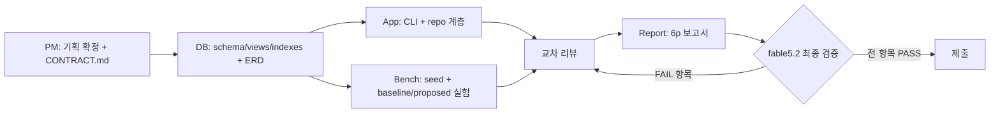

# 기획안 후보

기준 문서: [REQUIREMENTS.md](./REQUIREMENTS.md). 기획안마다 충족해야 하는 R-ID를 표시했다.

모든 기획안의 공통 전제
- 보고서는 논문 형식이고 Evaluation에서 **"성능이 왜 개선됐는지"**를 함수 단위 프로파일링이나 수치로 보여야 한다(R-18~20). 그래서 기획안마다 **측정 가능한 개선 기법(scheme) 1개 이상과 baseline**을 정해 두었다.
- 예시 보고서 3개(수강 장바구니, 항공 예약, 비교과 신청)와 주제가 겹치면 차별화 포인트가 있어야 한다.

---

## 기획안 A. 수강신청 + 정원 경쟁 제어 시스템

**한 줄 요약**: 장바구니 → 본신청 흐름에서 수천 명이 같은 분반에 동시에 몰려도 정원을 넘기지 않는 수강신청 서비스.

- **문제(실제 이슈)**: 수강신청 날 정원을 초과해 등록되는 문제, 시간표 충돌, 선수과목 미이수 상태에서의 신청. 예시 1은 등록번호만으로 삭제해서 다른 학생의 신청까지 지워지는 한계가 있었다(P4 s10).
- **테이블**: `student`, `department`, `professor`, `course`, `section`(분반·정원), `time_slot`, `section_time`(N:M), `prerequisite`(자기참조 N:M), `cart`, `enrollment`
- **기능**
  - 학생: 과목 검색, 장바구니 담기/삭제, 본신청, 시간표 조회, 수강 취소
  - 관리자: 과목·분반 개설, 정원 변경, 분반별 신청 현황
- **핵심 SQL**: 시간표 충돌 검사(JOIN과 구간 겹침 조건), 선수과목 검사(`NOT EXISTS`), 학과별 신청률(`GROUP BY`/`HAVING`), 분반 경쟁률 뷰, `capacity > ALL(...)` 비교
- **Scheme / Evaluation**
  - baseline: `SELECT enrolled` 후 앱에서 비교하고 `UPDATE`(check-then-act). 동시 요청에서 정원 초과가 생긴다.
  - proposed: 조건부 원자적 갱신 `UPDATE section SET enrolled = enrolled + 1 WHERE id = ? AND enrolled < capacity`를 트랜잭션으로 처리한다.
  - 지표: 스레드 N개(10~200) 동시 신청에서의 정원 초과 건수, 처리량(TPS), p95 지연. 시간표 충돌 검사에 인덱스를 적용하기 전후의 쿼리 시간.
- **스택**: Python + MySQL(InnoDB 행 잠금 실험이 명확하다). SQLite를 쓰면 `BEGIN IMMEDIATE`로 비교한다.
- **위험**: 예시 1과 주제가 거의 같다. 동시성 실험이 없으면 차별성이 없다.

## 기획안 B. 캠퍼스 카페 POS + 원재료 재고 관리

**한 줄 요약**: 주문하면 레시피(BOM)에 따라 원재료 재고가 자동으로 차감되고, 매출과 재고를 리포트하는 POS.

- **문제**: 소규모 매장은 메뉴 판매량과 원재료 재고가 따로 관리돼 품절과 폐기가 생긴다. 시간대별 매출 분석이 어렵다. 강의자료가 직접 예로 든 주제다(P1 s3, s14).
- **테이블**: `staff`, `shift`, `menu_item`, `category`, `ingredient`, `recipe`(menu↔ingredient N:M, 소요량), `orders`, `order_item`, `payment`, `stock_movement`(입고·차감·폐기 원장), `supplier`
- **기능**
  - 직원: 주문 등록(재고 부족 시 거절), 결제, 환불(재고 복구)
  - 점장: 입고 등록, 재고 부족 알림, 일·시간대·메뉴별 매출, 원가율 리포트
- **핵심 SQL**: 주문 1건 = `orders` + `order_item` + `stock_movement` 다건 트랜잭션, 레시피 JOIN으로 필요량 계산, 시간대별 `GROUP BY`, 현재 재고 뷰(`SUM(stock_movement)`), 평균보다 많이 팔린 메뉴(`> ALL`/`> SOME`)
- **Scheme / Evaluation**
  - ① 주문 적재: autocommit 단건 INSERT(baseline)와 배치 트랜잭션(proposed)을 비교한다. SQLite에서는 fsync 횟수 차이로 격차가 크게 나므로 원인 설명이 쉽다.
  - ② 매출 리포트: 원장 전체 집계(baseline)와 `(ordered_at, menu_id)` 복합 인덱스 + 일별 요약 테이블(proposed)을 비교한다.
  - 지표: 50만 건 `order_item`에서 초당 주문 처리 수, 리포트 쿼리 시간, `EXPLAIN` 실행 계획, cProfile 함수별 누적 시간.
- **스택**: Python + SQLite. 단일 파일이라 재현이 쉽다(R-47).
- **위험**: 주제가 흔하다. 차별점은 BOM 기반 재고 차감과 원장(ledger) 모델 설계 설명에 달려 있다.

## 기획안 C. 교내 스터디룸·실습실 장비 예약 시스템

**한 줄 요약**: 건물·호실·장비 조건으로 빈 공간을 찾고, 시간 겹침과 노쇼를 DB 수준에서 통제하는 예약 서비스.

- **문제(실제 이슈)**: 스터디룸 이중 예약, 노쇼로 인한 공실, "프로젝터 있는 6인실 중 오후 3~5시에 빈 방" 같은 조건 검색이 불가능하거나 느리다.
- **테이블**: `user`(학생/관리자), `building`, `room`, `equipment`, `room_equipment`(N:M), `reservation`, `reservation_member`(동반 이용자 N:M), `checkin`, `penalty`, `blackout`(점검·휴관 시간)
- **기능**
  - 학생: 조건(시간·인원·장비) 검색, 예약, 취소, 체크인, 내 예약·패널티 조회
  - 관리자: 호실·장비 등록, 휴관 시간 지정, 노쇼 일괄 패널티, 이용률 통계
- **핵심 SQL**
  - 겹침 검사: `NOT EXISTS (SELECT 1 FROM reservation r WHERE r.room_id = ? AND r.start_at < :end AND r.end_at > :start AND r.status = 'ACTIVE')`
  - 장비 전부 보유한 방(관계 나눗셈): `GROUP BY room_id HAVING COUNT(DISTINCT equipment_id) = :n`
  - 노쇼 패널티 일괄 처리 트랜잭션, 건물·시간대별 이용률 뷰, `capacity >= ALL(...)`
- **Scheme / Evaluation**
  - ① 빈 방 검색: 앱에서 전체 예약을 읽어 필터링(baseline 1), 인덱스 없는 SQL(baseline 2), `(room_id, start_at, end_at)` 복합 인덱스 + `NOT EXISTS`(proposed)를 비교한다.
  - ② 이중 예약 방지: check-then-insert(baseline)와 쓰기 트랜잭션(`BEGIN IMMEDIATE` 또는 `SELECT ... FOR UPDATE`) 안의 검사+삽입(proposed)을 비교한다. 동시 요청 시 중복 예약 건수를 측정한다.
  - 지표: 방 500개 × 예약 50만 건에서 검색 지연, `EXPLAIN QUERY PLAN`에서 SCAN이 SEARCH로 바뀌는지, 동시성 테스트의 충돌 건수, cProfile 함수별 시간.
- **스택**: Python + MySQL(InnoDB). SQLite는 쓰기 때 DB 전체를 잠가서 잠금 방식 간 비교 실험이 성립하지 않는다.
- **추천 이유**: 예시 3개와 겹치지 않는다. 실제 학교 이슈다(R-30). 시간 겹침, 관계 나눗셈, 동시성이라는 DB 고유의 문제가 Evaluation 수치로 바로 연결된다(R-46). 범위가 적당하다.
- **위험**: 시간 처리(타임존, 경계 포함 여부). 정책을 `[start, end)` 반열린 구간으로 고정하고 CHECK(`start_at < end_at`)를 둔다.

## 기획안 D. 교내 중고거래·분실물 마켓

**한 줄 요약**: 학생 간 중고거래와 분실물 등록·검색, 찜, 거래 후기를 제공하는 마켓.

- **문제**: 커뮤니티 게시판 기반 거래는 검색이 약하고 거래 상태와 신뢰도(후기)가 관리되지 않는다.
- **테이블**: `user`, `category`(자기참조 트리), `item`, `item_image`, `wishlist`(N:M), `offer`, `trade`, `review`, `lost_found`, `report`(신고)
- **기능**: 등록·수정·삭제(본인만), 키워드·카테고리·가격 검색, 찜, 가격 제안 → 거래 확정 → 후기, 신고 누적 시 숨김, 판매자 평점
- **핵심 SQL**: 카테고리 트리 재귀 CTE, 판매자 평점 집계 뷰, 거래 확정 트랜잭션(item 상태 + trade + 다른 offer 거절), 같은 카테고리 평균가보다 싼 매물(`< ALL`/`< SOME`)
- **Scheme / Evaluation**
  - ① 검색: `LIKE '%kw%'` 전체 스캔(baseline)과 SQLite FTS5 trigram 토크나이저(proposed)를 비교한다. MySQL이면 FULLTEXT ngram 파서를 쓴다.
  - ② 목록: `LIMIT/OFFSET`(baseline)과 키셋 페이지네이션 `WHERE (created_at, id) < (?, ?)`(proposed)를 비교한다. 페이지가 깊어질수록 격차가 커진다.
  - 지표: 매물 100만 건에서 검색·페이지 지연, 페이지 깊이별 그래프.
- **스택**: Python + SQLite 3.34 이상(trigram 필요). GUI를 원하면 Streamlit을 쓴다.
- **위험**: 한국어 검색에서 FTS 기본 토크나이저(`unicode61`)는 부분 일치가 안 된다. trigram이 없으면 실험이 성립하지 않으므로 착수 전에 SQLite 버전을 확인해야 한다.

## 기획안 E. 축구 유망주 스카우팅 DB: "다음 월드클래스" 추천 ★ 추천

**한 줄 요약**: 선수들의 시즌별 성장 궤적을 DB에 쌓고, 같은 나이 시점의 기록을 기준으로 월드클래스로 성장한 선수들과 현재 유망주를 비교해 다음 월드클래스 후보를 추천하는 스카우팅 서비스.

- **문제(실제 이슈)**: 구단은 이적료로 수천억 원을 쓰지만 유망주 평가는 스카우트의 주관에 크게 의존한다. 데이터 기반 스카우팅(Moneyball, Brentford·Brighton 사례, Opta·Wyscout 같은 상용 플랫폼)이 Introduction의 기존 연구 비교 재료가 된다(R-11, R-30).
- **데이터**: Kaggle "Football Data from Transfermarkt"(`davidcariboo/player-scores`, CC0). 테이블 12개, 경기 8.8만, 선수 5만, 출전 기록 189만, 시장가치 이력 65만 건 이상이다. 2026-07-06 기준으로 업데이트가 멈췄으므로 버전을 고정해 쓴다. 저장소에는 데이터 대신 다운로드·적재 스크립트를 둔다.
- **테이블**
  - 원천: `competition`, `club`, `player`, `game`, `appearance`(경기별 출전·득점·도움·출전 시간), `player_valuation`(시점별 시장가치), `transfer`
  - 파생: `season_stat`(선수×시즌 집계: 90분당 득점·도움, 출전 시간 비율, 리그 수준), `cohort_zscore`(나이×포지션군 기준 표준화 점수), `world_class_label`(정의 버전별 라벨)
  - 서비스: `app_user`(스카우트/관리자), `watchlist`(user↔player N:M), `scouting_note`, `recommendation_run`, `recommendation_item`
- **기능**
  - 스카우트: 선수 검색, 프로필(나이별 성장 곡선, 시장가치 추이), 같은 나이대 백분위, 유사 선수 Top-k, 다음 월클 추천 목록, 워치리스트·스카우팅 노트 CRUD(본인 것만 수정·삭제)
  - 관리자: 데이터 적재·갱신, 월클 정의 관리(예: 최고 시장가치 ≥ €60M 또는 5대 리그 주전 n시즌), 파생 테이블 재계산, 백테스트 실행
- **핵심 SQL**
  - 성장률: `LAG() OVER (PARTITION BY player_id ORDER BY season)`
  - 동나이대 백분위: `PERCENT_RANK() OVER (PARTITION BY age, pos_group ORDER BY g_a_per90)`
  - 유사 선수 k-NN: 같은 나이·포지션군에서 z-score 유클리드 거리를 계산해 `ORDER BY dist LIMIT k`
  - 추천 점수: 이웃 k명 중 월클 라벨 비율(`AVG(is_world_class)`)
  - "같은 나이에 모든 월클보다 출전 시간이 많은 유망주"(`> ALL`), 시점 고정 뷰(`as_of_date` 이전 데이터만 사용)
- **Scheme / Evaluation**
  - ① DB 성능(R-18~20)
    - baseline 1: 질의마다 원천 `appearance` 189만 행을 집계, 인덱스 없음
    - baseline 2: 같은 집계에 `(player_id, date)` 인덱스만 적용
    - proposed: 미리 계산한 `season_stat` + `cohort_zscore`와 `(age, pos_group)` 인덱스
    - 지표: 프로필·백분위·k-NN 질의 지연, `EXPLAIN QUERY PLAN`, cProfile 함수별 시간, 파생 테이블 갱신 비용(전체 재계산 vs 증분 갱신)
  - ② 추천 타당성(백테스트)
    - 2018-07 시점 데이터만으로 21세 이하 후보를 추천한 뒤, 2018~2026 실제 결과로 채점한다. 기준 시점은 착수 때 `SELECT MIN(date) FROM appearances`로 수집 시작 시점을 확인하고, 그 이후 3시즌 이상이 쌓인 시점으로 확정한다.
    - 비교 대상: (a) 무작위, (b) 당시 시장가치 순위(시장의 평가, 사실상 state of the art), (c) 제안 방식(궤적 유사도), (d) (b)+(c) 결합
    - 지표: precision@20, recall@50
- **스택**: Python + SQLite(3.25 이상, 윈도 함수 지원). 동시성이 주제가 아니므로 단일 파일 DB의 재현성이 더 중요하다(R-47).
- **위험과 대응**
  - **분석 보고서로 흐를 위험**: 채점 대상은 DB 서비스다. 추천 로직은 SQL로 구현하고(ML 라이브러리 금지), 사용자·워치리스트·노트 같은 서비스 기능과 DB 성능 평가를 보고서 중심에 둔다.
  - **미래 정보 누수**: 백테스트의 모든 질의는 `as_of_date` 필터를 거쳐야 한다. 이를 뷰와 파라미터로 강제하는 설계 자체가 Design 절의 내용이 된다.
  - **라벨 순환성**: 월클 라벨이 시장가치 기반이면 시장가치 순위(b)가 유리하다. 입력 피처에서는 시장가치를 빼고, 라벨 정의를 2개 이상(시장가치형 / 출전 실적형) 두고 비교한다.
  - **커버리지 편향**: 주요 대회(65개) 위주라 하부 리그와 유스 기록이 없고, 수집 시작 시점 이전 기록도 없다. 골키퍼와 수비수는 득점·도움 지표가 약하므로 공격수·공격형 미드필더를 1차 범위로 한다. 이 내용은 Limitation(R-17, R-35)에 쓴다.
  - **결과가 나쁠 가능성**: 제안 방식이 시장가치 순위보다 못할 수 있다. 그 경우에도 결합 방식(d)과 실패 원인 분석이 Findings가 된다.

---

## 비교

| 항목 | A 수강신청 | B 카페 POS | C 시설 예약 | D 중고 마켓 | E 축구 스카우팅 ★ |
|---|---|---|---|---|---|
| 예시와 차별성 | 낮음(예시 1과 동일 주제) | 중간(강의 예시 주제) | 높음 | 높음 | 매우 높음 |
| 실제 이슈성(R-30) | 높음 | 중간 | 높음 | 중간 | 높음(이적 시장, 데이터 스카우팅) |
| 핵심 DB 기술 | 동시성, 원자적 갱신 | 다건 트랜잭션, 집계, 원장 | 구간 겹침, 관계 나눗셈, 인덱스, 동시성 | FTS, 페이지네이션, 재귀 CTE | 윈도 함수, 파생(요약) 테이블, 시점 고정 질의, 대용량 적재 |
| Evaluation 수치 확보 | 쉬움 | 쉬움 | 쉬움 | 쉬움(trigram 전제) | 쉬움(DB 성능 + 백테스트 2축) |
| 구현 난이도 | 중 | 중 | 중 | 중상 | 중상(데이터 정제) |
| 기술 위험 | 낮음 | 낮음 | 낮음 | Korean FTS 의존 | 분석 보고서화, 라벨 순환성 |
| 권장 스택 | Python + MySQL | Python + SQLite | Python + MySQL(동시성 실험) | Python + SQLite ≥3.34 | Python + SQLite ≥3.25 |

권장 순서: **E → C → B → D → A**. E는 "위험과 대응"을 지키는 조건에서 1순위다. A는 동시성 실험을 반드시 넣는다는 조건에서만 채택한다.

---

## 에이전트 팀 구성 (Claude / GPT)

### 역할과 산출물

| 역할 | 담당 모델 | 산출물 | 관련 R-ID |
|---|---|---|---|
| PM / Architect | Claude | 확정 기획서, `docs/CONTRACT.md`(테이블·함수 시그니처·CLI 메뉴 트리) | R-14, R-32 |
| DB Engineer | Claude | `db/schema.sql`, `db/views.sql`, `db/indexes.sql`, ERD(mermaid `erDiagram` → 이미지) | R-15, R-31, R-40, R-44 |
| App Developer | GPT | `app/` CLI, `app/repo/` 데이터 접근 계층(파라미터 바인딩 전용), 트랜잭션 처리 | R-02, R-05, R-41~43, R-48 |
| Data & Bench | GPT | `scripts/seed.py`(시드 고정), `bench/*.py`, `EXPLAIN` 출력, cProfile 결과, 그래프 | R-19~21, R-46, R-49 |
| Report Writer | Claude | `report/report.md` → PDF 6페이지 | R-06~07, R-10~22, R-35 |
| Cross Reviewer | 작성자와 다른 모델 | 리뷰 코멘트. Claude 코드는 GPT가, GPT 코드는 Claude가 리뷰한다 | 전체 |
| **Final Gate** | **fable5.2** | `docs/VERIFICATION.md`(R-ID별 PASS/FAIL과 증거) | REQUIREMENTS §6 |

### 진행 흐름



### 운영 규칙
1. **계약을 먼저 고정한다**: `schema.sql`과 `CONTRACT.md`가 확정되기 전에는 App과 Bench가 착수하지 않는다. 확정 이후 스키마를 바꾸려면 PM 승인과 CONTRACT 갱신이 필요하다.
2. **파일 소유권**: 에이전트마다 디렉터리(`db/`, `app/`, `scripts/`·`bench/`, `report/`)를 나눠 동시 편집 충돌을 막는다.
3. **증거를 남긴다**: 보고서의 모든 수치는 `bench/results/*.csv`에서, 모든 코드 인용은 실제 파일에서 가져온다. fable5.2가 재실행해서 대조한다.
4. **재현 명령을 고정한다**: `python scripts/setup_db.py && python scripts/seed.py --seed 42 && python -m app`, `python bench/run_all.py`. 명령 2개 안팎이어야 한다(R-47).
5. **FAIL 루프**: fable5.2가 FAIL로 판정하면 해당 R-ID 담당 에이전트에게 돌려보내고, 수정 후 해당 항목만 재검증한다.

### 저장소 구조(제안)

```
DB_TermProject/
├─ docs/      REQUIREMENTS.md, PLANS.md, CONTRACT.md, VERIFICATION.md
├─ db/        schema.sql, views.sql, indexes.sql, erd.png
├─ app/       __main__.py, menus/, repo/, services/
├─ scripts/   setup_db.py, seed.py
├─ bench/     run_all.py, bench_*.py, results/
└─ report/    report.md, figures/, report.pdf
```

## 확정 사항
1. 기획안 E(축구 유망주 스카우팅), 종목은 축구
2. DBMS는 SQLite. 동시성 실험이 없어 단일 파일의 재현성을 택했다
3. 인터페이스는 한국어 CLI, 보고서는 영어
4. 실제 진행: Codex 사용량 한도 때문에 Pipeline·App·Bench·Report·CrossReview 모두 Claude 워커로 수행했다. 상세 규칙은 [CONTRACT.md](./CONTRACT.md)
